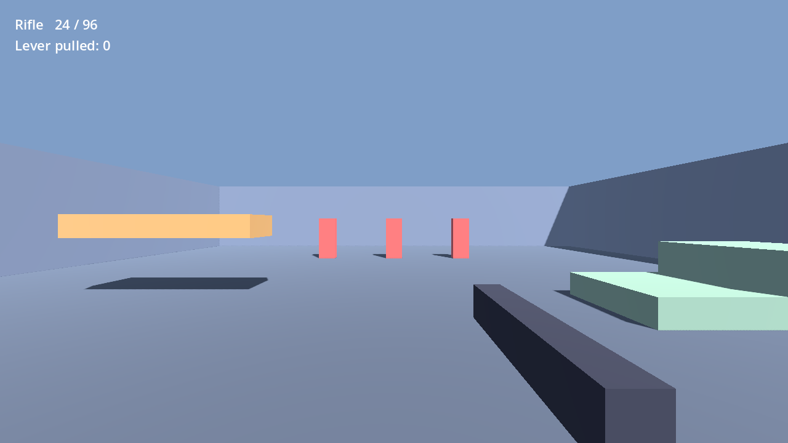
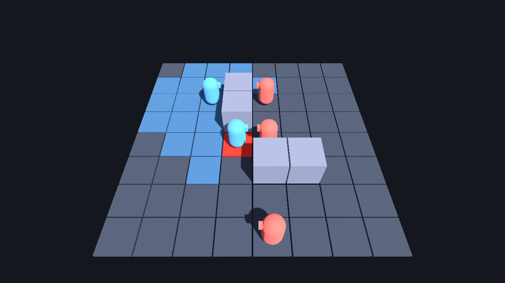
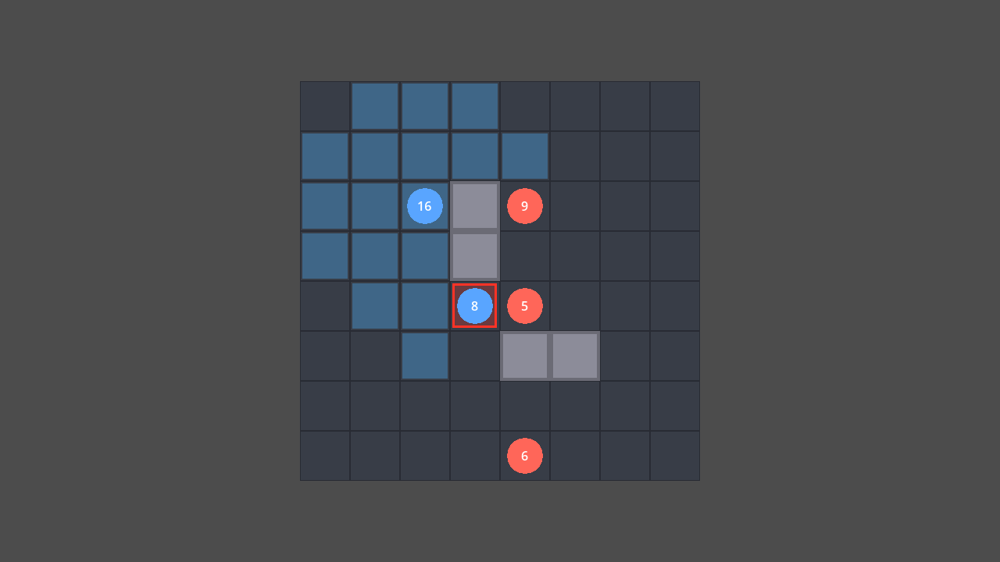

# Jam kits (Godot 4.7, Compatibility renderer)

Content-free kits for game-jam entries, plus the art-pipeline tests that measure which asset
workflows survive a one-week jam. "Content-free" means no meshes, textures or sounds: every
placeholder is built in code. Jam rules allow your own libraries and tools, not existing
projects, so copy the `addons/` folders you need into a fresh project.

| Addon | What it gives you | Tests |
|---|---|---|
| `addons/kit_tests` | Headless test runner + `TestCase` base class | used by all |
| `addons/kit_combat` | Health, hitbox/hurtbox, hit-stop, melee combo state machine | 15 |
| `addons/kit_touch` | Touch look pad and on-screen action buttons | via fps_kit |
| `addons/fps_kit` | First-person controller, weapons, viewmodel sway, interact ray (needs kit_combat) | 21 |
| `addons/grid_tactics` | Grid model, turns, telegraphing AI, 2D/3D presenters, winnability bot | 33 |

## Run things

`GODOT` below is the 4.7.2 **console, non-mono** exe (see `art_tests/ENV.md` for the path).

```bash
# All tests (about 12 s). Exit code 0 = everything passed.
GODOT --headless --path godot --script res://addons/kit_tests/run_tests.gd
# One file, or one test:
GODOT --headless --path godot --script res://addons/kit_tests/run_tests.gd -- --filter=test_fps::
GODOT --headless --path godot --script res://addons/kit_tests/run_tests.gd -- --filter=::test_bot_proves
# Play a demo (click to capture the mouse in the FPS one):
GODOT --path godot res://scenes/demos/fps_demo.tscn
GODOT --path godot res://scenes/demos/tactics_demo_3d.tscn
# Screenshot a scene (NOT headless: headless Godot draws nothing):
GODOT --path godot --script res://art_tests/tools/capture.gd -- --scene=res://scenes/demos/fps_demo.tscn --out=res://art_tests/runs/shot.png
# Prove every encounter in a folder is winnable (for a tactics game's CI):
GODOT --headless --path godot --script res://addons/grid_tactics/verify_encounters.gd -- res://encounters
```

After adding a new `class_name` script, run `GODOT --headless --path godot --import` once so
Godot registers it; until then other scripts report the class as "not declared".

## Demos (placeholders only)

| FPS kit | Grid tactics, 3D presenter | Grid tactics, 2D presenter |
|---|---|---|
|  |  |  |

The two tactics shots are the same battle at the same moment: the rules live in `GridModel`,
and the presenters only draw it. Blue tint = where the selected hero can walk; red = a cell
an enemy has telegraphed it will hit next turn.

## Art pipeline tests (`art_tests/`)

Twelve small experiments, one per genre in 2D and in 3D, each taking one hero asset and one
environment piece from nothing to a running scene and writing down what it cost.

| Read this | For |
|---|---|
| [`docs/ART_WORKFLOWS.md`](docs/ART_WORKFLOWS.md) | Which pipeline to use per genre, the rules learned, a 35-hour jam budget |
| [`art_tests/SCOREBOARD.md`](art_tests/SCOREBOARD.md) | The measured numbers per cell (generated by `art_tests/scoreboard.py`) |
| [`art_tests/gates/README.md`](art_tests/gates/README.md) | The automatic checks ("gates") for 2D and 3D art |
| `art_tests/cells/<genre>_<2d or 3d>/` | One experiment: `build.py` (the pipeline), `demo.tscn`, `report.json`, `screenshot.png` |

```bash
python art_tests/cells/fps_2d/build.py     # re-run one cell (cached images and downloads: free)
python art_tests/scoreboard.py             # rebuild the scoreboard from every report.json
```

The cells are **test content, not kit content**: nothing under `art_tests/` is exported with the
kits (see `export_presets.cfg`), and the add-ons in `addons/` still ship no art at all.
The 2D cells use images generated with Nano Banana; the 3D cells use downloaded CC0 / CC-BY
models, each listed in that cell's `CREDITS.md`.
